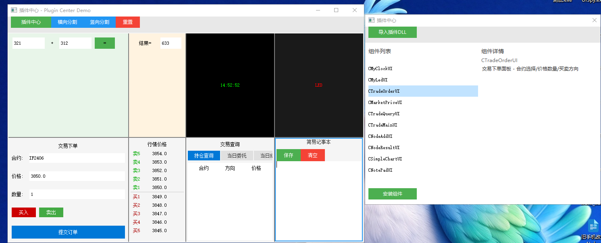

### **Duilib_Ultimate**

*** 
#### **目录**
* [项目简介](#项目简介)
* [功能简介](#功能简介)
* [插件组件开发](#插件组件开发)
* [作者简介](#作者简介)
* [项目支持](#项目支持)

***
#### **项目简介** 

DuiLib_Ultimate 是深耕 Windows 软件UI开发的利器， 以轻量化、高性能、易扩展 为核心，专为 Windows 平台打造极致桌面应用体验而生。
更多效果例子请查看：https://github.com/qdtroy/DuiLib_Demos 本项目基于该框架增加了插件组件开发模式

#### **功能简介** 

1、DuiLib_Ultimate是duilib库的增强拓展版，支持原有功能，修复了大量用户在使用中反馈的Bug，新增了用户需求的功能，并持续维护更新;

2、增加资源管理器支持，资源管理更加方便；

3、支持多国语言功能；

4、高DPI自适应的机制（接口简单，实用方便）；

6、控件支持样式表（Style）功能，控件属性管理设置更加方便易用；

7、新增功能（DateTime控件、IP地址控件、颜色选择控件、List网格线、List多选等）；

8、修正大量Bug：RichEdit输入变化消息、Combo字体设置、Button自动布局、控件右下边框绘制不完全、菜单控件崩溃等；

9、项目内置各种使用例子与编译选项（多字节Unicode，静态库和动态库）

#### **插件组件开发**

DuiLib_Ultimate 提供完整的插件组件开发框架，支持将自定义UI控件封装为独立DLL插件，通过插件中心动态加载、注册和管理。

**插件架构**

- **IPlugin 接口**：插件DLL需实现 `IPlugin` 接口（`OnLoad`/`OnUnload`/`GetInfo`），通过 `PLUGIN_EXPORT` 导出 `CreatePlugin`/`DestroyPlugin` 函数
- **CPluginManager**：插件管理器单例，负责插件的加载（`LoadPlugin`）、卸载（`UnloadPlugin`）和信息查询
- **CControlFactory**：控件工厂，插件在 `OnLoad` 时通过 `REGIST_DUICONTROL` 宏注册自定义控件类，主程序通过 `CreateControl` 动态创建
- **CPluginCenterDlg**：插件中心对话框，支持导入插件DLL、浏览组件列表、查看描述、安装组件到主窗口面板

**组件间联动（Node消息总线）**

- **CNodeUIBase**：基于 `CContainerUI` 的节点控件基类，自动注册到 `CNodeUIManager`
- **CNodeMessage**：消息结构体，包含消息类型、数据、发送者等信息
- **CNodeUIManager**：消息总线管理器单例，支持同步/异步消息广播
- **使用方式**：发送方调用 `PostNodeMessage`，接收方重写 `WantNodeMessage` 返回 `true` 并实现 `OnNodeMessage` 处理消息

**内置插件示例**

| 插件 | DLL | 组件 |
|------|-----|------|
| PluginCenterPlugin | PluginCenterPlugin.dll | CSimpleChartUI（简单图表）、CNotePadUI（记事本） |
| ExamplePlugin | ExamplePlugin.dll | CMyClockUI（时钟）、CMyLedUI（LED）、CTradeOrderUI（交易下单）、CMarketPriceUI（行情价格）、CTradeQueryUI（交易查询）、CTradeMainUI（交易主页）、CNodeAddUI（加法节点）、CNodeResultUI（结果节点） |

**主窗口拼接**

PluginCenter 示例程序支持通过分割面板（`CSplitContainerUI`）将多个插件组件拼接到一个主窗口中：
- 水平/垂直分割当前激活面板
- 拖拽分隔条调整面板比例
- 点击面板切换激活状态（蓝色边框标识）
- 通过插件中心导入DLL并安装组件到任意面板
- CNodeAddUI 和 CNodeResultUI 在不同面板中也能通过消息总线联动

**效果图**

**插件开发步骤**

1. 创建DLL项目，包含 `StdAfx.h`（引入 `UIlib.h`）和插件类（继承 `IPlugin`）
2. 在 `OnLoad` 中调用 `REGIST_DUICONTROL` 注册控件，调用 `RegisterDescription` 注册描述
3. 在 `GetInfo` 中返回插件信息（名称、版本、组件列表用 `|` 分隔）
4. 导出 `CreatePlugin`/`DestroyPlugin` 函数
5. 编译生成DLL，通过插件中心导入使用
